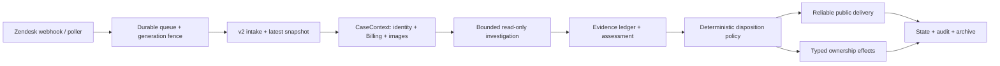

# Zendesk Agent v2

`zd-agent` 是 Dify SaaS 支持工单的证据驱动处理服务。当前代码只有一套生产决策核心：**Casework v2**。它从 Zendesk 获取最新对话，先在支持侧解析工作空间和 Billing，再进行有界、只读调查，最后独立决定客户回复、工单归属和生命周期状态。

旧版 verdict 分类器、通用 tool loop、subagent 编排、prompt 规则树和 `reply_type=handoff` 决策链已经移除。冻结的历史 outbox/state 只做幂等迁移或传输补偿，不能生成新的 v1 决策。

> 本仓库状态只代表本地实现。生产启用必须先通过无客户写入 replay、live dry-run 和小范围 canary；不要把本地 `casework` 配置当作已经部署的证据。

## 设计目标

- 能在支持侧确认的事实，不向客户重复追问。
- 表单邮箱优先、requester 邮箱兜底；唯一工作空间映射成功后禁止询问 Workspace ID。
- 套餐、订阅、续费、取消和 entitlement 以目标 tenant 绑定的 Billing 数据为准，Zendesk 标签和表单套餐只作为线索。
- 根因、影响和恢复必须分别有当前、目标绑定的证据；未知不能伪装成已确认。
- 单次工具失败先缩小查询或按类型重试，不能直接变成人工转交。
- 客户回复、内部归属和状态迁移是三个独立结果；模型不能自行选团队或调用写工具。
- 图片由受控 loader 读取，作为不可信观察证据参与调查，不要求客户重复截图中已清楚展示的信息。

## 运行链路



关键边界：

1. **Intake**：合并 Zendesk Messaging、表单和 requester 信息，刷新最新客户游标并去抖。
2. **Context**：按表单邮箱 → requester 邮箱解析 membership；只有多候选、冲突或无 membership 才可能要求客户消歧。
3. **Billing binding**：只接受与已解析 tenant 相同的 Billing 结果；target mismatch 直接 fail closed。
4. **Investigation**：按问题路由调用批准的只读工具，并区分当前事实、支持性证据、对照基线和历史导航。
5. **Assessment**：每个客户可见 claim 都绑定 evidence ID、时效、目标和 causal role。
6. **Disposition**：纯策略产生 `resolved`、`awaiting_customer`、`retry_pending` 或具体的人类/工程/SRE/安全动作。
7. **Effects**：公开回复经 freshness check、idempotency 和 durable outbox；归属命令使用 allowlist reason code 单独持久化。

## 工具能力

v2 调查 registry 在构造时拒绝任何 `is_write_operation` 或 `requires_sandbox` 工具。当前生产调查面包括：

- Zendesk：仅当前工单及其附件、Help Center；禁止任意用户读取和跨工单搜索；
- DB/Inspector：只允许已解析 tenant，或当前 requester 的 membership 解析；不向模型暴露原始 SQL；
- SigNoz：只暴露强制绑定已解析 tenant 的日志/trace 聚合与搜索能力；禁止全局查询和任意 trace ID 钻取；
- Source：部署版本、仓库、代码、diff、log 和 tags；
- GitHub MCP：PR、Issue 和 code search；
- 官方文档与内部 SaaS 知识；
- 历史工单记录，仅用于导航和对照，不作为当前根因依据。

Custom MCP 连接可以由管理面维护，但不会自动进入 v2 生产 registry。任何新的调查工具必须先满足只读、结构化结果、目标绑定和架构测试。

## 决策和状态

客户回复类型只有：

- `answer`：证据充分的直接回答；
- `ask`：仅询问客户独占且当前缺失的信息；
- `progress`：已确认需要继续内部调查时的进展说明；
- `close`：明确可关闭；
- `none`：无客户写入。

归属动作独立为 `none | support | billing | engineering | sre | security`。非 `none` 动作必须具有允许的 typed reason，例如客户明确要求人工、敏感账号写操作、已确认平台缺陷、已确认事故或安全审查。一般不确定、首次超时、没有发布日期、查不到 Workspace ID 都不是归属理由。

当前生命周期状态包括 `in_silence_window`、`processing`、`awaiting_customer`、`processed`、`owned`、`externally_owned` 和 `out_of_scope`。客户等待超时只结束自动化范围，不自动回复、不创建人工转交。

## 本地运行

要求 Python 3.12+ 和 `uv`。

```bash
uv sync --frozen --dev
cp .env.example .env
uv run zd-agent version
```

关键密钥通过环境变量注入，不写入 `config.yaml`：

- `OPENAI_API_KEY` 或 `ANTHROPIC_API_KEY`
- `ZENDESK_MCP_URL` / `ZENDESK_MCP_API_KEY`
- `ZENDESK_BROWSER_RELAY_URL` / `ZENDESK_BROWSER_RELAY_API_KEY`
- `DB_GATEWAY_URL` / `DB_GATEWAY_API_KEY`
- `SIGNOZ_MCP_URL` / `SIGNOZ_MCP_API_KEY`
- `SOURCE_MCP_URL` / `SOURCE_MCP_API_KEY`
- `GITHUB_MCP_URL` / `GITHUB_MCP_API_KEY`
- `DOCS_TOOL_SERVICE_URL` / `DOCS_TOOL_SERVICE_API_KEY`
- `NOTIFICATION_SERVICE_URL` / `NOTIFICATION_SERVICE_API_KEY`

单工单无客户写入分析：

```bash
uv run zd-agent run 3821 --dry-run
```

启动服务：

```bash
uv run zd-agent serve
```

`GET /healthz` 在全部关键后台任务运行时返回 200，否则返回 503。响应包含 casework mode、队列 pending/dead-letter、v2 effect outbox、公开回复 outbox、历史兼容 outbox和活跃 session 计数。

## 验证

提交前至少运行：

```bash
uv run pytest -q tests/casework tests/replay
uv run pytest -q
uv run ruff check src tests
uv run pyright -p pyproject.toml
uv build --offline
git diff --check
```

Golden replay 覆盖工作空间邮箱解析、Billing 权威绑定、禁止多余 Workspace ID 追问、运行时失败重试、视觉证据、直接产品回答和具体 ownership reason。测试永远不能发送真实客户消息。

## 生产发布门禁

1. 当前生产凭据与所有只读 MCP 健康检查通过。
2. `--dry-run` 对真实工单只读复核，确认 workspace、Billing、证据和回复均正确。
3. Golden replay、全量测试、Ruff、Pyright 和 build 全绿。
4. canary 只包含明确 ticket ID；确认无错 workspace、错套餐、重复/过期回复或无依据归属。
5. 扩大范围前逐单复核；失败时暂停消费或回滚上一稳定镜像，不恢复已删除的 v1 决策链。

当前已知外部门禁是模型账户必须有可用额度。出现 `429 credit_balance_exhausted` 时只能保持 no-write/dry-run，不能据此宣称 live canary 已通过。

## 代码结构

```text
src/zd_agent/
  casework/
    domain/        typed context, evidence, decisions, effects
    policies/      identity, Billing, evidence, disposition, ownership
    ports/         read, investigation, reply and effect contracts
    application/   context → investigate → assess → decide → compose
    adapters/      Zendesk/MCP/model/vision/delivery implementations
    replay/        sanitized deterministic replay
  runtime/
    casework_v2.py v2 runtime assembly
    runner.py      single production runner
  services/
    trigger_*      queue intake and lifecycle fencing
    reliable_public_reply.py
    casework_*     durable effects, ownership, notifications and audit
  tools/           approved read adapters plus isolated delivery transport
```

完整架构、约束和验收标准见 [v2 redesign specification](docs/specs/2026-08-11-zendesk-agent-v2-redesign.md)。
